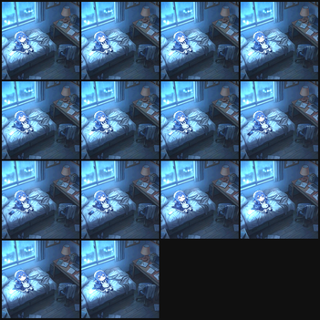

# STM32F411 外设实验：WS2812B 点阵 + OLED + 串口烧写工具

用 STM32F411（WeAct Black Pill，F411CEU6）做的三件事，全部纯寄存器、不依赖 HAL/CMSIS：

1. **WS2812B 8×8 点阵**（64 颗）：5 种灯效，板载 KEY（PA0）逐次切换；
2. **OLED 显示**（SSD1306 / SH1106，128×64，软件 I2C）：测试图案、像素画动画、视频帧循环；
3. **串口 ISP 烧写工具**（AN3155 协议，Python）：四线 USB-TTL 完成擦除、写入、跳转，不需要 ST-Link。

A register-level playground for STM32F411: WS2812B 8×8 matrix with 5 modes, a 128×64
mono OLED packed with image/animation tools, and a self-contained AN3155 UART flasher.

---

## 一、效果

| 模式 | 说明 |
|---|---|
| 0 | 彩虹流动（整条灯带铺彩虹，缓慢滚动） |
| 1 | 呼吸白（约 2 s 一个周期） |
| 2 | 彩色流水（彗星：头部颜色沿色轮变化，4 级拖尾） |
| 3 | 单色轮换（红/绿/蓝/黄/青/紫，每约 1 s 切换） |
| 4 | 关闭（全灭，省电） |
| 5 | **引脚选择**：短按逐个试脚（全白闪一下），长按 2 s 存入 Flash 并回到模式 0 |

按键：板载 **KEY = PA0**（内部上拉，按下为 0），每按一次切下一模式，串口同步打印 `MODE n`。

> 注意：整个 WS2812 功能只有一个固件 `ws2812_sel`（模式 + 选脚合并），
> 早期的 `ws2812_PA7` / `ws2812_modes` / `ws2812_bright` / `ws2812_allpins` 已删除。

## 二、硬件与接线

| 元件 | 型号 / 说明 |
|---|---|
| 主控 | WeAct Black Pill，STM32F411CEU6（512 KB Flash / 128 KB RAM） |
| 灯板 | WS2812B 8×8 点阵，64 颗，5 V 供电 |
| 烧写 | USB-TTL（CH340 等），四线：3V3 / TX / RX / GND |

| USB-TTL | Black Pill | 说明 |
|---|---|---|
| TX | PA10（USART1_RX） | 必须交叉 |
| RX | PA9（USART1_TX） | 必须交叉 |
| GND | GND | 必接 |
| 3V3 | 悬空（推荐） | 板子用 USB-C 自己供电 |

| 灯板 | 接到 |
|---|---|
| VIN / 5V | 外部 5 V 电源（≥2 A） |
| GND | 与板子 GND、TTL GND 共地 |
| DIN | 数据脚（见下） |

> ⚠️ 64 颗全白约 3.8 A。板子不要由 USB-TTL 的 3V3 供电；灯板与板子必须共地。

## 三、数据脚说明（重要）

本仓库的 `ws2812_modes` 固件把同一路波形**同时广播到** PA1–PA8、PA15、PB0–PB15，
因此 DIN 接在其中任意一脚都能点亮，用于在数据脚尚未确认时快速验证。
确认实际接线后，建议改成单脚输出：修改 `src/ws2812_modes.c` 里的 `MASK_A` / `MASK_B`
即可（PA0 保留给按键，PA9/PA10 保留给串口）。

## 四、构建

需要 `arm-none-eabi-gcc`。脚本默认从环境变量取工具链，也可直接改成绝对路径：

```bash
export GCC=arm-none-eabi-gcc
export OBJCOPY=arm-none-eabi-objcopy
./build_ws2812.sh          # 生成 out/ws2812_PA{0,1,6,7}.hex
```

手动编译一个：

```bash
arm-none-eabi-gcc -mcpu=cortex-m4 -mthumb -O2 -ffreestanding -std=c99 \
  -T f411.ld -nostdlib -Wl,--gc-sections \
  src/ws2812_modes.c src/startup.c -o build/app.elf -lgcc
arm-none-eabi-objcopy -O ihex build/app.elf out/app.hex
```

时钟：HSI 16 MHz → PLL（M=8, N=200, P=4）= **100 MHz**，不依赖外部晶振；
Flash 等待周期 3 WS（`FLASH_ACR`），位时序用 DWT 周期计数器做绝对时刻等待。

## 五、烧写（只用 USB-TTL）

1. `BOOT0` 按下（或接 3V3），点一下 `NRST`，松开 `NRST`，再松开 `BOOT0` → 进入芯片自带 bootloader；
2. 运行烧写脚本：

```bash
python tools/flash_an3155.py --port COM6 --hex out/ws2812_modes.hex --go
```

Windows 上双击 `flash.bat` 即可（内部调用同一脚本，窗口内留 40 s 供你按键进入 bootloader）。

3. 烧完后 `BOOT0` 接回 GND，按一下 `NRST` → 程序开始运行。

烧写工具的动作：`0x7F` 同步 → 全片擦除（`0x44` / 失败回退 `0x43`）→ 按 64 字节分块写入（`0x31`）→ 可选读回校验（`0x11`）→ 跳转（`0x21`）。
串口参数 115200、**8E1**（AN3155 规定偶校验）。

## 六、目录结构

```
src/            固件源码
  ws2812_modes.c    五模式主程序（PA0 按键）
  ws2812_f411.c     单脚版（PA7）基础固件
  ws2812_allpins.c  全引脚广播版
  ws2812_bright.c   全亮度演示
  btn_scan.c        按键引脚扫描工具
  f411_uart_test.c  16 MHz 最小串口测试
  oled_test.c       OLED 测试图案
  oled_whale.c      播放像素画/立绘帧
  oled_video.c      播放视频帧
  i2c_scan.c        I2C 扫描 + 双方向诊断
  startup.c         C 语言向量表与复位
f411.ld         链接脚本（512K Flash / 128K RAM）
tools/          串口 ISP 工具与验证脚本
  flash_an3155.py   烧写器（擦/写/校验/跳转）
  probe_bootloader.py  握手探测
  watch_serial.py   串口监听
  read_flash.py     只读回 Flash
  test_flash_sim.py 假设备离线自测
out/            预编译 hex
flash.bat / watch.bat   Windows 一键烧写 / 查看
```

## 七、OLED 显示（SSD1306 / SH1106，128×64）

### 接线（实测）

| OLED | Black Pill | 说明 |
|---|---|---|
| VCC | 3.3 V | 有的模块要 5 V，按丝印 |
| GND | GND | |
| SCL | **PB7** | 软件 I2C，开漏 + 内部上拉 |
| SDA | **PB6** | 同上 |

> ⚠️ 本机实测发现 SCL/SDA 与"常规习惯"（PB6=SCL）相反。若你的接法与这里不同，
> 改 `oled_*.c` 里的 `SCL_PIN` / `SDA_PIN` 即可；`i2c_scan.c` 的双方向扫描（PASS1/PASS2）
> 能一次判出是否接反。

### 固件

| 文件 | 内容 |
|---|---|
| `src/oled_test.c` | 地址探测（0x3C/0x3D）+ 边框/棋盘/斜线 + 竖条移动 |
| `src/oled_whale.c` | 播放 `anim_whale.h` 里的帧序列（像素画或立绘转换结果） |
| `src/oled_video.c` | 播放 `anim_video.h`（视频转帧，10 fps 循环） |
| `src/i2c_scan.c` | 总线扫描 + 空闲电平诊断；双方向各扫一遍 |

### 图像/视频转换工具

| 脚本 | 用途 |
|---|---|
| `tools/gen_whale2.py` | 手绘像素风角色（棋盘格头发）→ 4 帧 |
| `tools/gen_face.py` | 立绘 → 去白底 → 三档量化（白/50%棋盘/黑）→ 帧 |
| `tools/gen_video.py` | 视频帧 → 提对比度 + 中值 + 阈值 → 128×64 帧 |
| `tools/gen_video_port.py` | 竖屏版：64×128 竖直排版后旋转 -90°，人物铺满 |

视频处理用 `ffmpeg` 抽帧，例如：

```bash
ffmpeg -ss 2 -t 6 -i wallpaper.mp4 -vf "fps=10,crop=120:240:320:175,scale=64:128" assets/frames/f_%03d.png
python tools/gen_video_port.py     # 生成 src/anim_video.h
```

### 已知限制

- OLED 只有 1 bit，**不适合照片/暗调视频**：主体在画面里太小时，任何抖动或阈值都只能得到剪影；
- 想看清细节需换彩色屏（ST7735 160×80 / ILI9341 320×240，SPI）；
- 竖构图要"铺满"，必须把屏**物理竖放**，内容按 64×128 排版后再旋转。

## 八、踩过的坑（供参考）

1. **`FLASH_ACR` 漏设等待周期**：0 WS 跑 100 MHz 会导致取指随机出错，表现为"灯随机亮几颗、串口无输出"。必须 3 WS。
2. **AN3155 的尾随 ACK**：GET_ID / Read Memory 的应答结尾还有一个 `0x79`，不读掉会让后续命令整体错位一位。
3. **三/四线 USB-TTL 没有 DTR/RTS**：FlyMcu 的自动复位对它无效，必须手动 BOOT0+NRST。
4. **WS2812 是锁存型**：没有新数据时保持上一帧，所以"灯亮着"不能证明程序在跑；固件里加了每秒 `RUN` 心跳。
5. **3.3 V 驱动 5 V 灯板属欠驱动**（VIH≈0.7×VDD=3.5 V）：偏暗、颜色偏时，可把灯板降到 4.5 V 或加 74HCT245。
6. **I2C 的 SCL/SDA 接反**：现象是"IDLE 电平正常、扫描却一个器件都没有"；用双方向扫描（PASS1/PASS2）一次判出。
7. **OLED 初始化命令被静默截断**：一次 I2C 事务只发 15 个命令字节时，序列末尾的 `0xAF`（开显示）会丢失 → "命令有 ACK 但屏全黑"。必须分批发送。
8. **1-bit 屏不适合视频/照片**：信息量不足时任何抖动都只是噪声，应换彩屏或改画风。


## 十、WS2812 数据脚的运行时选择

数据脚存在 Flash 里，换脚不必重烧固件（固件仍是 `ws2812_sel`）：

1. 烧一次 `out/ws2812_sel.hex`（此后长期保留）；
2. 双击 **`set_pin.bat`**，输入引脚序号（0=BROADCAST，1=PA1 … 25=PB15）；
3. 脚本只往 Flash 的 `0x08060000` 写一个 32 位配置字 `0x57530500 + N`（不擦程序）；
4. 板子复位后即按新引脚输出。

也可以直接跑一条命令：

```bash
python tools/flash_an3155.py --port COM6 --pin-sel 7
# 等价于 --write32 0x08060000=0x57530507
```

板子上还保留按键操作（不接线也能改）：短按 KEY 逐个试脚（每次全白闪一下），
长按 2 秒把当前脚写入同一地址。两者写的是同一份配置，互不冲突。

| 序号 | 引脚 | | 序号 | 引脚 |
|---|---|---|---|---|
| 0 | BROADCAST | | 13 | PB3 |
| 1–8 | PA1–PA8 | | 14–21 | PB4–PB11 |
| 9 | PA15 | | 22–25 | PB12–PB15 |
| 10–12 | PB0–PB2 | | | |


## 十一、彩色 SPI TFT（ST7735 / ST7789 / ILI9341）

### 接线（默认，可改 `src/tft_test.c` 顶部宏）

8 针模块的丝印通常是 `BLK / RS / RST / CS / SC / DI / GND / VCC`，对应关系：

| 屏上丝印 | 含义 | Black Pill |
|---|---|---|
| VCC | 3.3 V | 3.3 V |
| GND | 地 | GND |
| **SC** | SPI 时钟（SCL/SCK） | **PB13** |
| **DI** | 数据输入（MOSI/SDA） | **PB15** |
| **RS** | 寄存器选择（= DC） | **PB14** |
| **CS** | 片选 | **PB12** |
| **RST** | 复位 | **PB10** |
| **BLK** | 背光 | 3.3 V（建议串 100 Ω） |

> 若丝印是 `SCL/SDA/CS/DC/RES/BLK` 或 `CLK/DIN/...`，含义相同，按“时钟→PB13、数据→PB15、
> 选择→PB14、片选→PB12、复位→PB10”一一对应即可。

> 这组引脚避开了 PA0（按键）、PA9/PA10（串口）、PB6/PB7（OLED I2C），
> 三块屏可以同时接着，只烧不同固件即可。

### 固件

一个源文件 `src/tft_test.c`，用 `-DTFT_CTRL` 选控制器：

| 宏值 | 控制器 | 分辨率 | 产物 |
|---|---|---|---|
| **4** | **ST7735 1.44" 128×128**（默认偏移 2/1） | **128×128** | **`out/tft_144.hex`** |
| 4 无偏移 | 同上但 XOFF/YOFF=0 | 128×128 | `out/tft_144o.hex` |
| 4 + 反相 | 同上再加 INVON | 128×128 | `out/tft_144i.hex` |
| 1 | ST7735 1.8" | 128×160 | `out/tft_st7735.hex` |
| 2 | ST7789 | 240×240 | `out/tft_st7789.hex` |
| 3 | ILI9341 | 240×320 | `out/tft_ili9341.hex` |
| 1 + 偏移 | ST7735 + XOFF2/YOFF1 | 128×160 | `out/tft_st7735o.hex` |
| 1 + 偏移 + 反相 | 同上再加 INVON | 128×160 | `out/tft_st7735i.hex` |

**1.44 寸 128×128（本次实测型号）先烧 `tft_144.hex`**：画面偏移就用 `tft_144o.hex`，
颜色反相用 `tft_144i.hex`。

后两版是给“1.8 寸蓝板”准备的：这类模块常见画面偏移 2/1 像素、颜色反相，
先用 `tft_st7735.hex`，画面偏或反相就换 `o` / `i` 版。

**不知道屏幕是哪种芯片时，三个都烧一遍**，哪个能正确显示就用哪个（烧错不会损坏屏幕）。

### 测试画面（自动循环）

1. **纯色**：红 → 绿 → 蓝 → 白 → 黑，各 400 ms（验证 SPI 通信与颜色顺序）
2. **8 条彩条**（验证像素排列、有无错位/重影；1.44 寸每条约 16 列）
3. **RGB 渐变**（验证 16 位色深、无断层）
4. **边框 + 方块沿对角线移动**（验证坐标与刷新速率）

串口（PA9/PA10，115200）同步打印：

```
TFT TEST  ctrl=ST7735  128x160
init done
RED
GREEN
...
```


### 壁纸播放（128×128 动画）

`out/tft_wall.hex` 播放"大肥鱼"壁纸的 14 帧循环（128×128、RGB565、10 fps）。
素材由 `tools/gen_tft_video.py` 从视频帧生成：

```bash
# 1) 抽帧（全分辨率，5 fps 取 30 帧，脚本再挑 14 帧）
ffmpeg -ss 2 -t 6 -i wallpaper.mp4 -vf fps=5 assets/full/f_%03d.png
# 2) 生成 RGB565 帧数据（居中裁成正方形、提亮暗部）
python tools/gen_tft_video.py --frames 14
# 3) 编译
./build_ws2812.sh      # 产出 out/tft_wall.hex
```

预览：

| 参数 | 值 |
|---|---|
| 帧数 / 帧率 | 14 帧 / 10 fps（每帧 100 ms） |
| 每帧数据 | 128×128×2 B = 32 KB |
| 占用 Flash | 约 450 KB（512 KB 中剩约 62 KB，最多可放 15 帧） |
| 提亮处理 | R×1.55+18、G×1.55+22、B×1.35+20（暗色壁纸在小屏上过暗） |

> 帧数受 Flash 限制：想要更流畅需减分辨率（如 96×96 → 每帧 18 KB，可放 25 帧）
> 或改硬件 SPI + DMA 提高刷新率。

### 现象对照

| 现象 | 原因 | 处理 |
|---|---|---|
| 全屏纯白/纯黑 | SPI 没通或 RES 接错 | 查 SCL/SDA/CS 与共地 |
| 颜色反相（红变青） | 部分模块需 `INVON` | 在初始化里加/去 `0x21` |
| 画面偏向一边、有彩边 | ST7735 需设置偏移 | 改 `TFT_XOFF/TFT_YOFF`（常见 2/1、24/0） |
| 图像上下颠倒/镜像 | MADCTL 方向位不对 | 改 `0x36` 参数 |
| 只有一半画面显示 | 分辨率宏与屏幕不符 | 换对应的 `-DTFT_CTRL` |

### 已知限制

- 软件 SPI，全屏填充约 0.1–0.3 s（128×160 更快），适合静态画面与简单动画，不适合视频；
- 未使用 DMA；若需流畅动画，可改为硬件 SPI + DMA（引脚需换到 SPI 复用脚）。


## 十二、AHT21B 温湿度传感器

4 针模块（`SCL / GND / SDA / VCC`），I2C 地址固定 **0x38**，与 OLED 的 0x3C 不冲突，可共用一条总线。

### 接线

| AHT21B | Black Pill | 说明 |
|---|---|---|
| VCC | 3.3 V | **不要接 5 V** |
| GND | GND | |
| SCL | **PB7** | 与 OLED 共线（本项目实测 OLED 的 SCL 在 PB7） |
| SDA | **PB6** | 与 OLED 共线 |

### 两个固件

| 固件 | 作用 | 产物 |
|---|---|---|
| `aht21_test` | 只读温湿度，**串口**每秒打印 `T=25.31C H=48.72%`，便于先确认模块可用 | `out/aht21_test.hex` |
| `aht21_oled` | 温湿度 → **128×64 OLED**（TEMP/HUM 两行 + 湿度横条 + 冷热提示） | `out/aht21_oled.hex` |
| `aht21_tft` | 温湿度 → **1.44 寸彩色 TFT**（3 倍大字、温度按冷热变色、湿度条） | `out/aht21_tft.hex` |
| `aht21_tft_o` | 同上，但面板偏移为 0 | `out/aht21_tft_o.hex` |

`aht21_tft` 的布局：顶部标题条 `ENV MONITOR`，中间两行 3 倍大字（温度/湿度），
下方湿度进度条，底部 `HOT / COMFORT / COLD`。

实现上用 **32 KB 帧缓冲**（`uint16_t lcd[128*128]`）在 RAM 里画完整屏，再一次性推给屏幕；
若逐像素调 `tft_rect`，每像素一条 SPI 命令，会慢到无法接受。

烧 `aht21_test` 先看串口，通了再换 `aht21_oled`。失败时串口会打印：

| 输出 | 含义 |
|---|---|
| `INIT ERR 1` | 器件无 ACK —— 接线 / 3.3 V / 上拉 |
| `INIT ERR 2` | 状态一直忙（bit7=1） |
| `MEAS FAIL` | 触发后读不到数据 |

### 协议要点

```
上电等待 >=100 ms
读状态，bit3 = 校准使能；为 0 时发 0xBE 0x08 0x00 初始化
触发测量：0xAC 0x33 0x00，等 80 ms
读 6 字节：湿度 = b1<<12 | b2<<4 | b3>>4
          温度 = (b3&0x0F)<<16 | b4<<8 | b5
RH% = raw / 2^20 * 100
T℃ = raw / 2^20 * 200 - 50
```

> **32 位溢出陷阱**：`raw_h * 10000` 与 `raw_t * 20000` 最大约 1.05e10 / 2.1e10，
> 远超 uint32 上限（4.29e9），直接乘会溢出成乱值（表现为温度恒为 0.00）。
> 固件里的写法是先右移 4 位再乘：`((raw >> 4) * 10000) >> 16`，
> 精度损失约 0.01，实测 25.00 ℃ 得 24.99 ℃、48.00 %RH 得 47.99 %RH。

### 注意（与 WS2812 冲突）

WS2812 固件默认"全引脚广播"会占用 PB6/PB7，此时传感器与点阵无法同时工作。
先用 `ws2812_sel` 的模式 5（或 `set_pin.bat`）把点阵定到具体引脚，
PB6/PB7 就空出来给 I2C 了。

## 十三、许可

MIT License，见 `LICENSE`。
